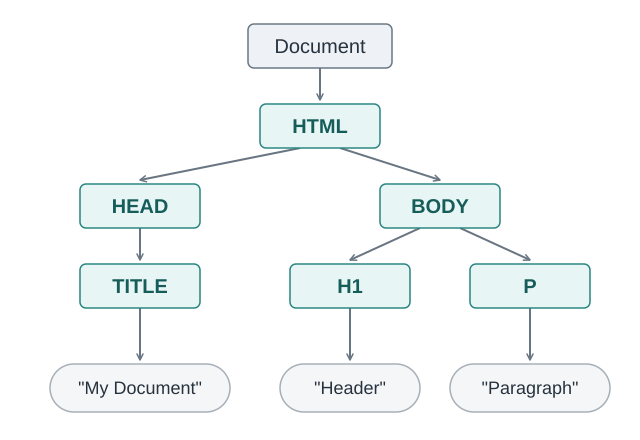

<!-- _class: lead -->

# "Dynamisches" HTML
## Web Anwendungen
## Sven Eppler


---

<!-- _class: chapter -->

# HTML ist statisch
## Und trotzdem ist das "moderne" Web dynamisch

---

# HTML ist statisch

- HTML als Beschreibungssprache kennt keine Dynamik
    - Keine Variablen, keine Schleifen, keine "externe" Einflussnahme
- Eine HTML-Datei auf dem Server ändert sich nicht "von selbst"
- Das kann auch ein Vorteil sein:
    - Content, der sich nicht häufig ändert, muss nicht immer dynamisch erzeugt werden
    - Statischer HTML-Code enthält keine serverseitige Anwendungslogik und hat dadurch oft eine minimale Angriffsfläche.

---

# Was passiert im Browser

1) Browser sendet HTTP Request an Server
1) Server sendet HTTP Response an Browser
1) Browser parst das ankommende HTML und erzeugt den DOM
1) Browser zeigt HTML an

Solange jetzt keine weitere Interaktion geschieht (Mausklick, Neu laden, Formular absenden, etc.), bleibt die Website "statisch" im Browser.

---

# Was passiert im Browser

- Wird mit der statischen Website interagiert, beginnt der Zyklus von vorn.

1) Bei einer vollständigen Navigation wird der bisherige "Page Context" (DOM, EventListener usw.) verworfen
1) Browser sendet HTTP Request an Server
1) Server sendet HTTP Response an Browser
1) Browser beginnt HTML zu empfangen und zu parsen
1) Browser zeigt HTML an

Für rein statische Webseiten war das nie ein großes Problem. Bei Webanwendungen führt dieses Verhalten zu Problemen.

---

# Was passiert im Browser

Live-Beispiel: `$repo/beispiele/HTML/Statisches-HTML/index.html`

- Die Webseite ist statisch (Änderungen an der Datei werden erst nach einem Reload sichtbar)
- Beim Wechseln zwischen `index.html` und `seite2.html` wird der bisherige DOM verworfen

---

<!-- _class: lead -->

# Mehr Dynamik beim Client
## JavaScript to the rescue!

---

# JavaScript macht HTML dynamisch

- Zwei Fähigkeiten von JavaScript ermöglichen "dynamisches" HTML:
    - Es ermöglicht Manipulationen am DOM zur Laufzeit
    - Es bietet die Möglichkeit auf Events zu reagieren
- Dadurch wird es plötzlich möglich zu sagen:
> Wenn jemand auf diesen Button klickt, erzeuge ein neues HTML Element mit einem bestimmten Content

---

# Events

- Browser erzeugen verschiedenste Events:
    - Technisch bedingte (`load`, `deviceorientation`, `error`)
    - Durch Interaktion bedingt (`click`, `focus`, `keydown`)
- Auf alle diese Events kann man sich via JavaScript registrieren
    - D. h., man sagt dem Browser damit: "Wenn jemand klickt, sag mir Bescheid."
    - Dafür gibt es die Methode `addEventListener`

```javascript
window.addEventListener("deviceorientation", () => {
    console.log("Das Gerät wurde gedreht");
});
```

---

# Events

- Events haben fast immer auch zusätzliche Daten

```javascript
window.addEventListener("click", (event) => {
    const clickedElement = event.target;
    console.log("Jemand hat auf etwas geklickt:", clickedElement);
});
```

---

# Events

- Events können das "Standardverhalten" des Browsers unterbinden
- Das `submit`-Event wird ausgelöst, wenn ein Formular abgeschickt wird

```javascript
someForm.addEventListener("submit", (event) => {
    // Verhindert, dass der Browser das Formular abschickt,
    // nachdem diese Funktion ausgeführt wurde
    event.preventDefault();
});

```

---

# Document Object Model (DOM)

- Der Browser parst das vom Server gelieferte HTML. Dabei entsteht eine hierarchische Baumstruktur, die [DOM](https://developer.mozilla.org/en-US/docs/Web/API/Document_Object_Model) genannt wird.



---

# DOM: Selektieren von Elementen

- Es können einzelne oder auch viele Elemente aus dem DOM selektiert werden
- Grundsätzlich gibt es zwei elementare Wege:
    - "Tree traversal", also den Baum von Knoten zu Knoten ablaufen
    - Mittels CSS-Selektoren ein Element oder mehrere Elemente direkt selektieren

---

# DOM: Selektieren von Elementen - Tree Traversal

```html
<body>
    <p>
        Ich bin ein Absatz.
        
    </p>
</body>
```

```javascript
const p = document.body.children[0];
const img = p.children[0];
```

[MDN: Tree traversal](https://developer.mozilla.org/en-US/docs/Web/API/Document_Object_Model/Selection_and_traversal_on_the_DOM_tree#tree_traversal_at_a_high_level)

---
# DOM: Selektieren von Elementen - ID, Class, Tag

```html
<body>
    <p>
        Ich bin ein Absatz.
        
    </p>
</body>
```

```javascript
// Die Plural-Methoden liefern eine HTMLCollection
document.getElementsByTagName("img"); 
document.getElementsByClassName("bilder"); 
// Liefert das Element oder null, wenn kein Treffer gefunden wird
document.getElementById("mein-bild");
```

[MDN: Selecting Elements by ID, Class, TagName](https://developer.mozilla.org/en-US/docs/Web/API/Document_Object_Model/Selection_and_traversal_on_the_DOM_tree#selecting_elements_by_id_class_or_tag_name)

---

# DOM: Selektieren von Elementen - CSS Selectors

```html
<body>
    <p>
        Ich bin ein Absatz.
        
    </p>
</body>
```

```javascript
// Liefert eine statische NodeList
document.querySelectorAll("body p img");
// Liefert das erste passende Element oder null, wenn es keinen Treffer gibt
document.querySelector("body p img");
document.querySelector("#mein-bild"); // ID selector
document.querySelector("img.bilder"); // Class selector
```

[MDN: Selecting Elements with CSS selectors](https://developer.mozilla.org/en-US/docs/Web/API/Document_Object_Model/Selection_and_traversal_on_the_DOM_tree#selecting_elements_with_css_selectors)

---

# DOM Manipulation

- Auf das Document Object Model kann man im Browser via JavaScript durch die globale Variable `document` zugreifen:
- Es ermöglicht:
    - Das Erzeugen neuer Elemente
    - Das verschieben von Elementen im DOM
    - Das entfernen von Elementen im DOM
    - Das ersetzen von Elementen im DOM

---

# DOM: Erzeugen von Elementen

- Mittels `document.createElement()` kann ein neues HTML-Element (Tag) erzeugt werden
- Dieses Element existiert zunächst losgelöst
    - Es hat keinen Parent
    - Es wird in der Website nicht angezeigt
- Damit es angezeigt wird, muss es in den aktuellen DOM "eingehängt" werden

```javascript
const newHeading = document.createElement("h1"); // Neues <h1> Element erzeugen
newHeading.innerText = "Ich bin der Text der Überschrift";

const parentNode = document.querySelector("body"); // Parent Element ermitteln
parentNode.appendChild(newHeading); // Neues Element dem Parent als neues Kind "anhängen"
```

---

# DOM: Erzeugen von vielen Elementen

- Mittels `template`-Tags lässt sich ein ganzer HTML-Block bequem via JavaScript erzeugen:
    - Dafür wird der Inhalt des `template`-Elements geklont
    - Der Klon kann dann verändert werden
    - Anschließend wird der Klon in den DOM eingehängt

[MDN: Template tag](https://developer.mozilla.org/en-US/docs/Web/HTML/Reference/Elements/template)


---

# DOM: Manipulationen

Wichtige Funktionen:

```javascript
listOfElements.append(newHtmlElement); // als letztes Kind einfügen
listOfElements.prepend(newHtmlElement); // als erstes Kind einfügen

oldItem.replaceWith(newHtmlElement); // ersetzen
oldItem.before(newHtmlElement); // davor einfügen
oldItem.after(newHtmlElement); // danach einfügen

oldItem.remove(); // sich selbst entfernen

listOfElements.replaceChildren(newHtmlElement); // Kinder ersetzen
```

---

<!-- _class: lead -->

# JavaScript Laden
## Blockaden, Reihenfolgen, Probleme

---

# JavaScript Laden

- JavaScript wird in HTML über ein `script`-Tag eingebunden
    - Inline-Scripts werden ausgeführt, sobald sie vom Parser erreicht werden
- Externe Scripts werden geladen und anschließend ausgeführt
- Klassische Scripts ohne `async` oder `defer` unterbrechen das HTML-Parsing während ihrer Ausführung
    - Langsam ladendes/ausgeführtes JavaScript kann die Anzeige verzögern
- Außerdem kann es zu Timing-Problemen zwischen HTML und JavaScript kommen
    - Zum Beispiel, wenn JavaScript auf HTML-Elemente zugreift, die im Dokument erst nach dem `script`-Tag stehen

---

# JavaScript Laden

- Die Attribute `async` und `defer` verändern das Verhalten externer Scripts
    - Beide laden das Script parallel zum HTML-Parsing
    - `async`: Das Script wird ausgeführt, sobald es geladen ist. Die Ausführung kann das HTML-Parsing unterbrechen.
    - `defer`: Das Script wird nach dem HTML-Parsing und vor dem `DOMContentLoaded`-Event ausgeführt. Mehrere `defer`-Scripts werden in Dokumentreihenfolge ausgeführt.
- `defer` eignet sich oft für externe Scripts, deren Ausführungsreihenfolge wichtig ist.

```html
<script defer src="some-very-big.js"></script>
```

---

# JavaScript Laden - Wann ist alles da?

- In der Regel ist es wichtig, dass das eigene JavaScript erst ausgeführt wird, wenn auch der DOM vollständig aufgebaut ist
    - Sonst können Event-Listener nicht zu bestimmten Elementen registriert werden
    - Führt zu einer "nicht reagierenden" Anwendung
- Dafür lösen Browser ein besonderes Event aus: `DOMContentLoaded`
    - Damit signalisiert der Browser: Das HTML wurde vollständig geparst und der DOM aufgebaut
    - Jetzt kann aus JavaScript heraus sicher damit gearbeitet werden

---

# JavaScript Laden - Wann ist alles da?

```html
<html>
    <head>
        <script>
            document.addEventListener("DOMContentLoaded", () => {
                // Wird ausgeführt, sobald das HTML geparst und der DOM aufgebaut ist
                const button = document.querySelector("button");
                button.addEventListener("click", () => {
                    alert("Hier ist dein Popup");
                });
            });
        </script>
    </head>
    <body>
        <button>Popup!</button>
    </body>
</html>
```

---


<!-- _class: lead -->

# The magic sauce
## Das alles verknüpfen

---

# Events+DOM Manipulation=Dynamisches HTML

Um HTML-Seiten dynamisch zu verändern, braucht es im Wesentlichen nur zwei Schritte:

1) Auf `Events` reagieren
1) Innerhalb des `EventHandlers` den DOM verändern

Auf dieser grundlegenden Idee basieren viele Single-Page-Application-Frameworks (SPA) wie Angular, React, Svelte oder Vue.js.

---

# Live-Beispiel

- Entwicklung einer simplen Todo-App
    - Umsetzung des reinen HTML
    - Ergänzen von Events
    - Dynamische Erzeugung von HTML-Elementen
    - Dynamisches Löschen von HTML-Elementen
- Wenn noch Zeit ist: Styling via [Bootstrap](https://www.getbootstrap.com)
