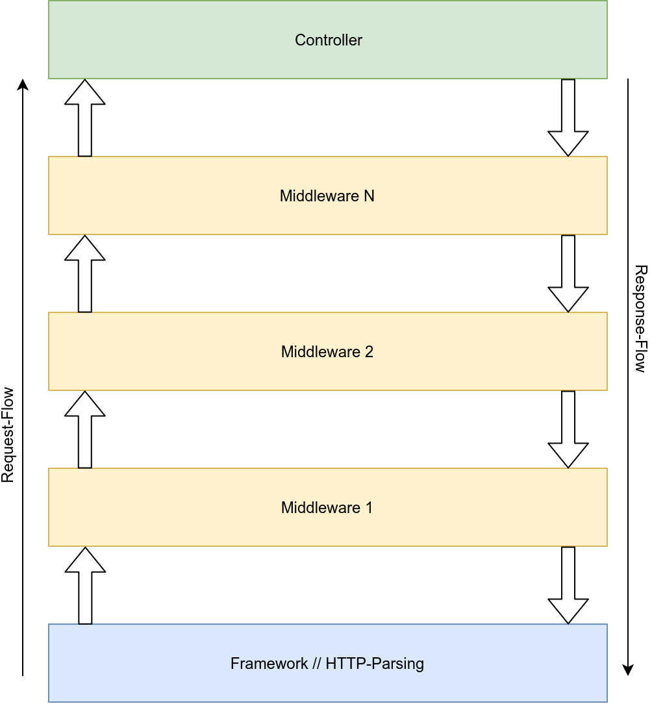
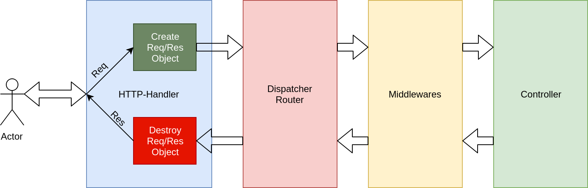

<!-- _class: lead -->

# Webframeworks 1x1
## Web Anwendungen
## Sven Eppler


---
<!-- _class: lead -->

# Was tut das Webframework für mich?

---

# Conv-over-Conf vs. Conf-over-Conv

- Conventions-over-Configuration
    - Code First, think later
    - Die Konvention definiert die Projektstruktur/Methodik
    - Defaults nehmen einem Entscheidungen ab
    - "Man kommt schnell vom Boden weg"
    - Kennt man die Konvention nicht, ist man "verloren"
    - Weicht man vom HappyPath ab, ist die Konvention oft im Weg

---

# Conv-over-Conf vs. Conf-over-Conv

- Configuration-over-Convention
    - Think first, code later
    - Funktionalität ist erst nach der Konfiguration verfügbar
    - Deutlich längere "Bootup"-Phase
    - Passt sich besser dem Problem an
    - Erfordert mehr Erfahrung/vorausschauende Entscheidungen
    - In-Depth-Verständnis des Gesamtsystems

---

# HTTP Request Parsing

- Der HTTP-Request schlägt als erstes am Framework auf
    - Unterstützung von HTTP 1.1 / 2 / 3
- Zerlegen des Requests
    - Requst-Line
    - Header
    - Body
- Bereitstellen eines "Requests"-Objektes für später
- Weitergabe des Requests an einen Dispatcher/Router

---

# Dispatcher // Router

- Match den HTTP-Request auf eine Action
    - Action = Der Quellcode
- Mögliche Regeln:
    - HTTP-Verb
    - Request-Header
    - Request-URL
    - Authentifizierter-Benutzer
- Mögliche Ziele:
    - Actions in Controllern
    - Lambdas (In-Line-Actions)

---

# Controller

- Stammt aus dem Model-View-Controller-Pattern
    - Der Controller ist bindeglied zwischen WebFramework und Business Logic
    - Enthält den Code der die Anwendung "aus macht"
    - Funktionen/Methoden in einem Controller sind "Actions"
    - Diese Actions sind das Ziel vom Router/Dispatcher

---

<!-- _footer: "" -->
# Middlewares



- Middlewares sind Schichten zwischen HTTP-Parsing und Controllern / Actions
- Können den Request vorzeitig beenden
  (z.B. Authentication Required)
- Können die Response modifizieren
  (z.B. JSON Serialisierung)
- Gemeinsame Funktionalität kann so generalisiert werden
  (z.B. Logging, User aus DB Laden)

---

# Response generieren
- Das Framework erzeugt ein Response-Objekt
    - Setzen des HTTP-Status Code
    - Setzen des HTTP-Headern
    - Setzen des HTTP-Body
- Middlewares übernehmen die Konvertierung von "High Level Objects"
    - JSON Formatierung, Bilder ausgeben, Template-Engine, etc.
- Low-Level-Response-Manipulation selten notwendig
  (z.B. Header setzen, Body selber schreiben)
- Das Response-Objekt wandert wieder durch die Middleware zurück und kann hier modifiziert werden

---

# Request-Lifetime

- Request-Lifetime meint:
    - Wie lange "leben" Request/Response spezifische Objekte innerhalb des Frameworks
- Jeder Request ist isoliert, hat also seinen eigenen Context (z.B. eigene Request/Response Objekte)
- Sobald die Response auf die Leitung geschrieben wurde, wird der Context zerstört und die Request-Lifetime endet
- Im Request/Response Objekt können **keine** Daten persistiert werden!
- Daraus ergibt sich: Ein Request ist stateless!

---

# Request-Lieftime



---

# Model-View-Controller

- Pattern für Software-Design
- Trennung von:
    - Datenhaltung (Model)
    - Anzeige (View)
    - Geschäftslogik (Controller)
- Auch nicht-MVC-Frameworks implementieren Teile davon (z.B. Controller)
- Frameworks:
    - Ruby on Rails, Mojolicous, Spring MVC, Django, ZendFramework
- Im Backend nach wie vor ein relevantes Pattern

---

<!-- _class: lead -->

# Wie sieht das in der Praxis aus?

---

# Route Configuration in Express

- Die „App“-Instanz von Express liefert Basis-Routing:
    - `app.get("/", (req, res) => { … });`
    - `app.post("/avatar/upload", (req, res) => { … });`
- Das „Router“-Objekt abstrahiert das Routing von der App, dadurch ist es austauschbar/übertragbar
```javascript
var router = express.Router();
router.get("/", (req, res) => { … });
router.post("/avatar/upload", (req, res) => { … });
app.use("/“, router);
```

- Details: https://expressjs.com/en/guide/routing.html

---

# Basis Routing mit Express

```javascript
var express = require('express');
var app = express();

app.get("/", (req, res) => {
  res.send("Hello World!");
});

app.post("/path/to", (req, res) => { … });

module.exports = app;
```

---

# Routing mit Router in Express

```javascript
var express = require('express');
var router = express.Router();
var app = express();

router.get("/", (req, res) => {
  res.send("Hello World!");
});

router.post("/path/to", (req, res) => { … }

app.use('/', router);

module.exports = app;
```

---

# Basis Routing vs. Routing Instanz

- Basis Routing
    - Sofort vorhanden
    - Routing sind fest mit der App verdrahtet
    - Für kleine Anwendungen übersichtlich
    - Komplexe Routing-Strukturen machen die App unübersichtlich und schlecht wartbar
- Router Instanz
    - Muss zunächst erzeugt werden
    - Kann in jeder Express-App eingehängt werden
    - Bei komplexem Routing können Unter-Router erzeugt werden
    - Erlaubt das Strukturieren von Routen in Ordnern/Dateien

---

# Router Instanz: Vorteil komplexe URL Strukturen

- Getrennte JavaScript Datei pro Kategorie
    - z.B. Users.js, Uploads.js, Posts.js
    - Jede Kategorie definiert ihr eigenes URL-Routing
    - Typischerweise im Unterordner „routes“
- Eine Änderung in „Users.js“ führt nicht zu einer Änderungen in den anderen JavaScript files
- Getrennte Verantwortlichkeiten
    - Weniger Merge-Conflicts in git!

---

# Express Beispiel: Todo API

- Im Git Repository: $repo/Beispiele/Node.js/Todo-Backend/